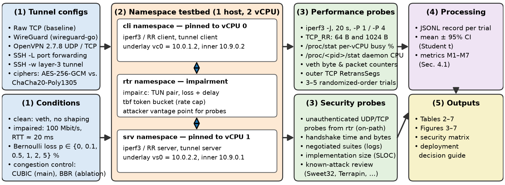
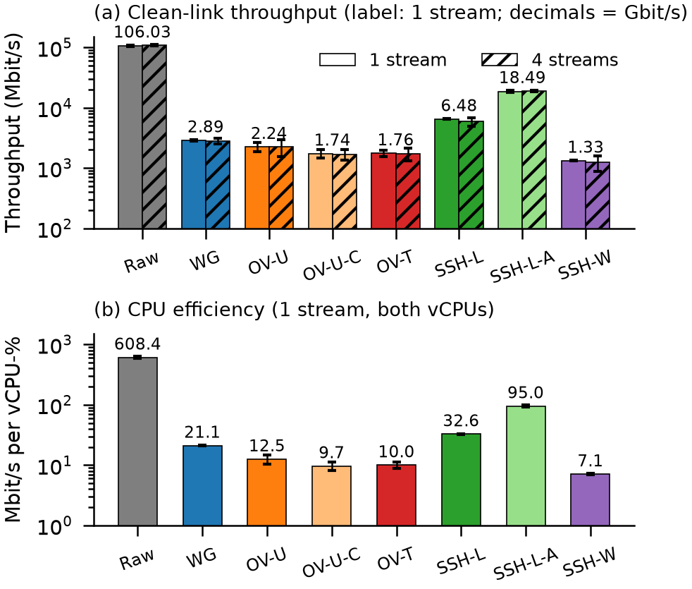
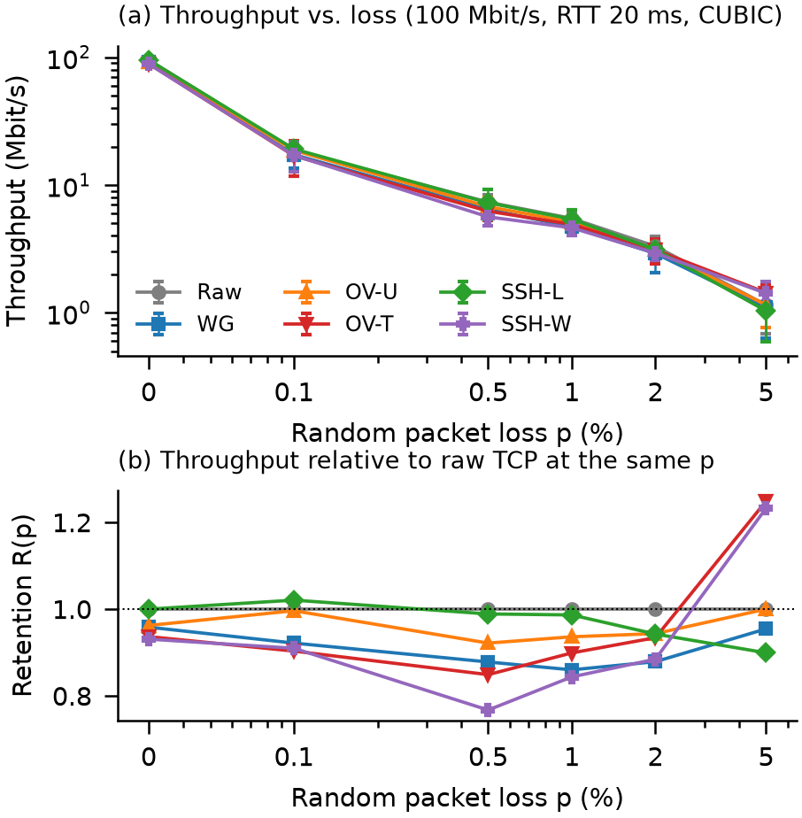

<div align="center">

# VPN vs. SSH Tunneling
### A Comparative Performance and Security Analysis

**Hubert Yakpé Trolindo** · University of Central Florida

[](paper/report.docx)
[](paper/guide.docx)
[](https://cybsecoff31.github.io/vpn-vs-ssh-tunnel-benchmark/)
[](LICENSE)
[](LICENSE-CC-BY-4.0.md)

</div>

WireGuard, OpenVPN and SSH tunnels are often deployed interchangeably to protect data in transit. This repository contains the testbed, raw measurements and analysis behind a controlled comparison of **six tunnel configurations and two cipher variants**. The study covers clean-link efficiency, robustness to packet loss, and security posture. Every number in the report can be regenerated from the files here, and a step-by-step guide explains how to repeat the whole experiment from an empty virtual machine.

<p align="center"></p>

## Testbed

All experiments ran on one virtual machine named `cyborg`, created in UTM on an Apple Silicon Mac.

| Item | Value |
|---|---|
| Guest | Ubuntu Server 24.04.3, Linux 6.8, arm64 |
| VM resources | 2 vCPUs (about 4.0 GHz, measured), 8 GiB RAM, 30 GiB disk |
| Host | UTM, QEMU 9.1 ARM virtual machine with hardware virtualization |
| Crypto acceleration | ARMv8 AES instructions |
| Topology | Three network namespaces (`cli`, `rtr`, `srv`) joined by veth pairs, MTU 1500 |
| CPU pinning | Client side on vCPU 0, server side on vCPU 1 (`taskset`) |
| Built from source | OpenVPN 2.7.8 (OpenSSL 3.0.13), OpenSSH 10.6p1, wireguard-tools v1.0.20260223, wireguard-go b3bc704 (Go 1.24.7), iperf3 3.22 |
| From Ubuntu | iproute2 6.1, GCC 13.3, Python 3.12.3 |

## Key findings

| | Throughput, clean link (1 stream) | CPU cycles / byte | 64 B RTT overhead | Unauthenticated probe |
|---|---:|---:|---:|---|
| Raw TCP (baseline) | 106.03 Gbit/s | 0.5 | — | — |
| **WireGuard** (wireguard-go) | 2.89 Gbit/s | 15.2 | +25 µs | silent |
| **OpenVPN-UDP** (AES-256-GCM) | 2.24 Gbit/s | 25.5 | +18 µs | silent with tls-crypt |
| **OpenVPN-TCP** | 1.76 Gbit/s | 32.1 | +19 µs | silent with tls-crypt |
| **SSH -L** (ChaCha20 / AES-GCM) | 6.48 / 18.49 Gbit/s | 9.8 / 3.4 | +22 / +20 µs | version banner |
| **SSH -w** (layer-3 tunnel) | 1.33 Gbit/s | 45.3 | +22 µs | version banner |

Means of 5 trials. Cycles per byte use the measured 4.0 GHz clock. The report (Table 2) gives 95% confidence intervals.

1. **Per-packet work, not "user space", sets the cost.** OpenVPN and SSH -w make about 10× more context switches per MB than WireGuard (1,105–1,202 against 110), and changing OpenVPN's cipher moves its speed only within the confidence intervals.
2. **TCP-over-TCP "meltdown" is conditional.** With CUBIC, every tunnel stays within about 23% of plain TCP up to 2% loss, with no collapse. With BBR, tunnels that carry TCP inside TCP run **18–44%** below plain TCP, yet still about 11–52× faster than under CUBIC.
3. **Security, not speed, separates the tunnels.** WireGuard and tls-crypt-protected OpenVPN ignore unauthenticated probes, while sshd announces `SSH-2.0-OpenSSH_10.6`. In exchange, SSH -L exposes only a single port.

<p align="center">
  
  
</p>

## Repository layout

```
├── paper/            Final report and reproduction guide (DOCX)
├── lab/              Testbed: namespaces, impairment emulator, tunnels, experiments
├── results/          Raw data: one JSON record per trial (*.jsonl), probe outcomes
├── analysis/         Aggregation (mean ± 95% CI), figure scripts, comparison script
├── tables/           Script and inputs that rebuild Tables 1–7
├── figures/          All figures used in the report
├── tools/            Small measurement helpers
├── recording/        Recorder used to capture the console screenshots of the guide
├── documents/        Scripts that generated the report and the guide
├── docs/             GitHub Pages project site
└── make_all.sh       Rebuilds summaries, Figures 1–7 and Tables 1–7 from results/
```

| File | Purpose |
|---|---|
| `paper/report.docx` | Final report |
| `paper/guide.docx` | Step-by-step reproduction guide, from creating the VM to the final figures, with real console screenshots |
| `lab/topo.sh` | Builds the `cli` / `rtr` / `srv` namespace testbed; `impair <loss> <delay_ms> <rate_mbit> [seed]` inserts the lossy link |
| `lab/impair.c` | User-space link emulator (two TUN devices, Bernoulli loss + fixed delay); replaces `netem` |
| `lab/tun.sh` | Brings each tunnel up/down: `raw wg ovpn-udp ovpn-tcp ovpn-udp-chacha ssh-L ssh-L-aes ssh-w` |
| `lab/servers.sh` | Starts the iperf3 and latency servers in `srv` |
| `lab/sshd_config` | Configuration of the lab sshd |
| `lab/run.py` | Measurement library: iperf3 JSON, `/proc` CPU accounting, interface counters, TCP retransmissions |
| `lab/exp_clean.py` · `lab/exp_loss.py` · `lab/exp_ctx.py` · `lab/probe.py` | Clean-link campaign · loss sweep (CUBIC/BBR) · context switches · security probes |
| `lab/rr.py` | TCP request/response latency probe (netperf TCP_RR style) |
| `lab/rerun_failed.py` | Finds the failed runs in a loss-sweep file and repeats them with the same tunnel, loss and seed: `sudo python3 /opt/lab/rerun_failed.py cubic\|bbr` |
| `analysis/analyze.py` | Aggregates `results/` into `analysis/summary.json` and `analysis/ctx.json` |
| `analysis/pipeline.py` · `analysis/fig_extra.py` · `analysis/figs.py` · `analysis/fig_ctx.py` | Figure 1 · Figures 2 and 5 · Figures 3, 6 and 7 · Figure 4 |
| `analysis/compare.py` | Prints a new run next to the published numbers (paths set for the guide's `~/rerun` copy) |
| `tables/make_tables.py` · `tables/inputs.json` | Rebuilds Tables 1–7; `inputs.json` holds the measured clock, key exchange and SLOC counts |
| `tools/freq.c` | Measures the vCPU clock used for cycles per byte (ARM64 only) |
| `recording/agent.py` · `go.py` · `show.py` · `setup.sh` | Recorder on the VM and the tools that sent it commands through the UTM shared folder; not needed to repeat the experiment |
| `documents/mk_report.py` · `mk_guide.py` · `gcontent.py` · `steps.py` | Generated `report.docx` and `guide.docx`; paths point to the author's working folders |

## Reproducing

**Re-create the figures and tables from the published data** (Python 3 with `numpy` and `matplotlib`; the study used numpy 2.5.3 and matplotlib 3.11.2):

```bash
pip install -r requirements.txt
./make_all.sh
```

**Re-run the experiments.** Follow [`paper/guide.docx`](paper/guide.docx): it covers every command, with the output to expect. In short, you need a Linux host with network namespaces, `/dev/net/tun`, the `tbf` qdisc and root access. Three system changes are required that are easy to miss:

```bash
sudo modprobe tcp_bbr                                                       # BBR is a module on Ubuntu
sudo sysctl -w net.ipv4.tcp_allowed_congestion_control="reno cubic bbr"     # otherwise BBR silently stays CUBIC in the namespaces
sudo usermod -p '*' root                                                    # the PAM-less lab sshd refuses a locked root account
id sshd || sudo useradd -r -d /var/empty -s /usr/sbin/nologin sshd         # privilege-separation user
```

Then install the lab, generate fresh keys and run the campaigns:

```bash
sudo cp -r lab /opt/lab                     # scripts expect /opt/lab
sudo gcc -O2 -pthread -o /usr/local/bin/impair /opt/lab/impair.c
# Generate fresh keys in /opt/lab/keys (never reuse published keys). Section VI of the guide gives the exact commands:
#   wg genkey/pubkey (wg_srv.*, wg_cli.*), ssh-keygen -t ed25519 (ssh_host_ed25519, id_ed25519 + authorized_keys),
#   RSA-4096 CA + server/client certs with keyUsage and extendedKeyUsage (ca.crt, server.*, client.*),
#   openvpn --genkey tls-crypt tc.key
sudo /opt/lab/topo.sh up
sudo /opt/lab/servers.sh
sudo python3 /opt/lab/exp_clean.py
sudo python3 /opt/lab/exp_loss.py cubic && sudo python3 /opt/lab/rerun_failed.py cubic
sudo python3 /opt/lab/exp_loss.py bbr   && sudo python3 /opt/lab/rerun_failed.py bbr
sudo python3 /opt/lab/probe.py && sudo python3 /opt/lab/exp_ctx.py
```

The OpenVPN certificates must carry the `keyUsage` extension, because `tun.sh` uses `--remote-cert-tls server`; without it the handshake fails with `VERIFY KU ERROR`. The campaigns take about 1 hour 40 minutes.

Absolute clean-link numbers vary with hardware, and the loss sweep depends mostly on the emulated link. The report's Section 5.3 lists the limitations: single host, user-space WireGuard, Bernoulli loss.

## Citation

```bibtex
@techreport{yakpetrolindo2026vpnssh,
  author      = {Yakp{\'e} Trolindo, Hubert},
  title       = {Network and Infrastructure Security: A Comparative Performance and Security Analysis of {VPN} vs. {SSH} Tunneling},
  institution = {University of Central Florida},
  year        = {2026},
  type        = {Course Project Report},
  url         = {https://github.com/cybsecoff31/vpn-vs-ssh-tunnel-benchmark}
}
```

## License

- **Code** (`lab/`, `analysis/`, `tables/`, `tools/`, `recording/`, `documents/`, `make_all.sh`, `docs/` markup): [MIT License](LICENSE).
- **Data, figures and paper** (`results/`, `figures/`, `paper/`): [Creative Commons Attribution 4.0 (CC BY 4.0)](LICENSE-CC-BY-4.0.md).

Third-party tools used in the study (OpenVPN, OpenSSH, WireGuard, iperf3) keep their own licenses and are not redistributed here.
