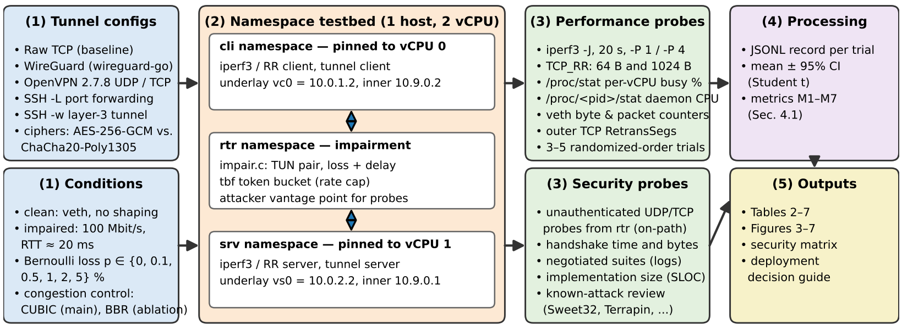
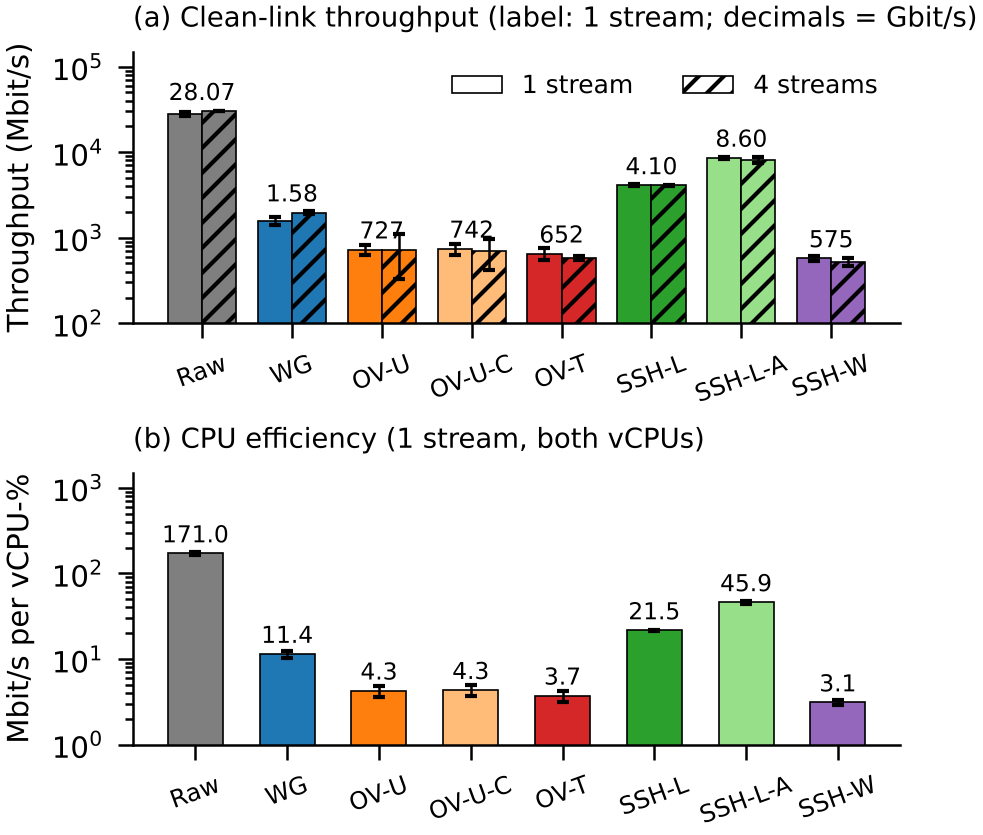
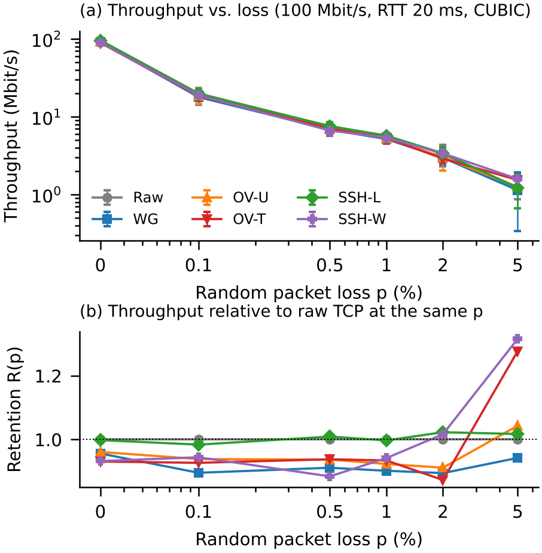

<div align="center">

# VPN vs. SSH Tunneling
### A Comparative Performance and Security Analysis

**Hubert Yakpe Trolindo** · University of Central Florida

[](paper/Report.pdf)
[](https://cybsecoff31.github.io/vpn-vs-ssh-tunnel-benchmark/)
[](LICENSE)
[](LICENSE-CC-BY-4.0.md)

</div>

WireGuard, OpenVPN and SSH tunnels are often deployed interchangeably to protect data in transit. This repository contains the testbed, raw measurements and analysis behind a controlled comparison of **six tunnel configurations and two cipher variants**. The study covers clean-link efficiency, robustness to packet loss, and security posture. Every number in the paper can be regenerated from the files here.

<p align="center"></p>

## Key findings

| | Throughput, clean link (1 stream) | CPU cycles / byte | 64 B RTT overhead | Unauthenticated probe |
|---|---:|---:|---:|---|
| Raw TCP (baseline) | 28.07 Gbit/s | 1.3 | — | — |
| **WireGuard** (wireguard-go) | 1.58 Gbit/s | 19.6 | +113 µs | silent |
| **OpenVPN-UDP** (AES-256-GCM) | 727 Mbit/s | 52.6 | +48 µs | silent with tls-crypt |
| **OpenVPN-TCP** | 652 Mbit/s | 60.2 | +43 µs | silent with tls-crypt |
| **SSH -L** (ChaCha20 / AES-GCM) | 4.10 / 8.60 Gbit/s | 10.4 / 4.9 | +61 µs | version banner |
| **SSH -w** (layer-3 tunnel) | 575 Mbit/s | 72.2 | +52 µs | version banner |

Means of 5 trials. The paper (Table 2) gives 95% confidence intervals.

1. **Per-packet work, not "user space", sets the cost.** OpenVPN and SSH -w make about 13× more context switches per MB than WireGuard, and changing OpenVPN's cipher does not change its speed.
2. **TCP-over-TCP "meltdown" is conditional.** With CUBIC every tunnel tracks plain TCP up to 5% loss. With BBR, tunnels that carry TCP inside TCP lose **28–43%** of their throughput.
3. **Security, not speed, separates the tunnels.** WireGuard and tls-crypt-protected OpenVPN ignore unauthenticated probes, while sshd announces `SSH-2.0-OpenSSH_10.6`. In exchange, SSH -L exposes only a single port.

<p align="center">
  
  
</p>

## Repository layout

```
├── paper/            Final report (PDF + DOCX)
├── lab/              Testbed: namespaces, impairment emulator, tunnels, experiments
├── results/          Raw data: one JSON record per trial (*.jsonl), probe outcomes
├── analysis/         Aggregation (mean ± 95% CI) and figure scripts
├── figures/          All figures used in the paper
└── docs/             GitHub Pages project site
```

| File | Purpose |
|---|---|
| `lab/topo.sh` | Builds the `cli` / `rtr` / `srv` namespace testbed; `impair <loss> <delay_ms> <rate_mbit> [seed]` inserts the lossy link |
| `lab/impair.c` | Userspace link emulator (two TUN devices, Bernoulli loss + fixed delay); replaces `netem` |
| `lab/tun.sh` | Brings each tunnel up/down: `raw wg ovpn-udp ovpn-tcp ovpn-udp-chacha ssh-L ssh-L-aes ssh-w` |
| `lab/run.py` | Measurement library: iperf3 JSON, `/proc` CPU accounting, interface counters, TCP retransmissions |
| `lab/exp_clean.py` · `lab/exp_loss.py` · `lab/exp_ctx.py` · `lab/probe.py` | Clean-link campaign · loss sweep (CUBIC/BBR) · context switches · security probes |
| `lab/rr.py` | TCP request/response latency probe (netperf TCP_RR style) |
| `analysis/analyze.py` | Aggregates `results/` into `analysis/summary.json` and `analysis/ctx.json` |

## Reproducing

**Re-create the figures from the published data** (Python 3 with `numpy` and `matplotlib`):

```bash
pip install -r requirements.txt
python3 analysis/analyze.py
python3 analysis/figs.py && python3 analysis/fig_extra.py && python3 analysis/fig_ctx.py && python3 analysis/pipeline.py
```

**Re-run the experiments.** You need a Linux host with network namespaces, `/dev/net/tun`, the `tbf` qdisc and root access. The study used OpenVPN 2.7.8, OpenSSH 10.6p1, wireguard-go, wireguard-tools, iperf3 3.22 and iproute2, all built from source, on a 2-vCPU VM.

```bash
sudo cp -r lab /opt/lab                     # scripts expect /opt/lab
gcc -O2 -pthread -o /usr/local/bin/impair /opt/lab/impair.c
# Generate fresh keys in /opt/lab/keys (never reuse published keys):
#   wg genkey/pubkey (wg_srv.*, wg_cli.*), ssh-keygen -t ed25519 (ssh_host_ed25519, id_ed25519 + authorized_keys),
#   RSA-4096 CA + server/client certs (ca.crt, server.*, client.*), openvpn --genkey tls-crypt tc.key
sudo /opt/lab/topo.sh up
sudo python3 /opt/lab/exp_clean.py
sudo python3 /opt/lab/exp_loss.py cubic && sudo python3 /opt/lab/exp_loss.py bbr
sudo python3 /opt/lab/probe.py && sudo python3 /opt/lab/exp_ctx.py
```

Expect absolute numbers to vary with hardware; the relative patterns are what the paper discusses. Its Section 5.3 lists the limitations: single host, userspace WireGuard, Bernoulli loss.

## Citation

```bibtex
@techreport{yakpetrolindo2026vpnssh,
  author      = {Yakpe Trolindo, Hubert},
  title       = {Network and Infrastructure Security: A Comparative Performance and Security Analysis of {VPN} vs. {SSH} Tunneling},
  institution = {University of Central Florida},
  year        = {2026},
  type        = {Course Project Report},
  url         = {https://github.com/cybsecoff31/vpn-vs-ssh-tunnel-benchmark}
}
```

## License

- **Code** (`lab/`, `analysis/`, `docs/` markup): [MIT License](LICENSE).
- **Data, figures and paper** (`results/`, `figures/`, `paper/`): [Creative Commons Attribution 4.0 (CC BY 4.0)](LICENSE-CC-BY-4.0.md).

Third-party tools used in the study (OpenVPN, OpenSSH, WireGuard, iperf3) keep their own licenses and are not redistributed here.
